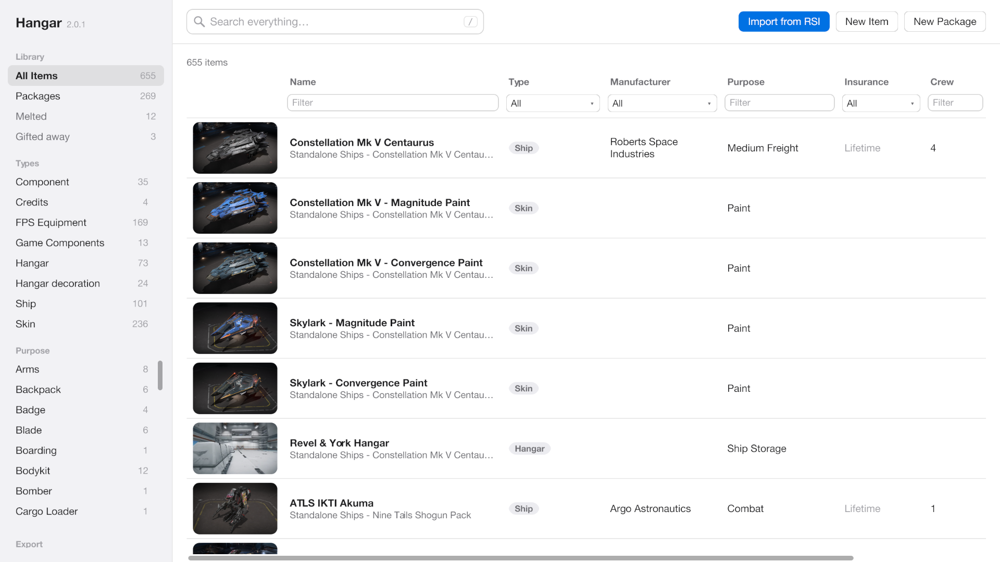
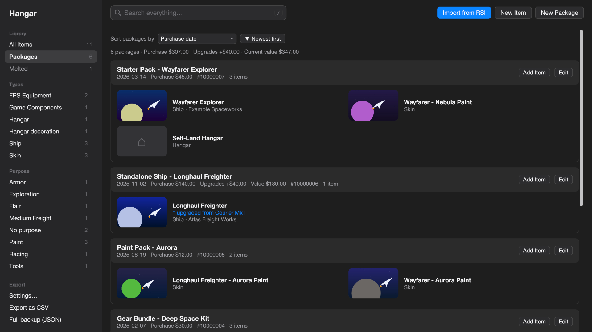

# Hangar

A desktop app for your Star Citizen hangar: search everything you own so you don't buy it twice, keep a picture of
every ship and item, and fill it straight from your RSI pledges instead of typing things in. It runs on your own
computer, needs nothing installed, and keeps your data on your computer.



> **Unofficial.** Hangar is a fan-made tool. It is not affiliated with, endorsed or sponsored by Cloud Imperium Games
> or Roberts Space Industries. Star Citizen®, Roberts Space Industries® and Cloud Imperium® are trademarks of Cloud
> Imperium Rights LLC and Cloud Imperium Rights Ltd. Hangar only reads your own account pages, in your own signed-in
> browser, and sends them nowhere but into Hangar on your computer. It never sees or stores your RSI password.
> It comes with no warranty: keep backups. See [NOTICE.md](NOTICE.md).
>
> Open source under the [MIT License](LICENSE).

## Download

| Computer | Download |
|---|---|
| Mac (macOS 11 or later, Apple Silicon and Intel) | [Download Hangar-macOS.zip](release/Hangar-macOS.zip?raw=true) |
| Windows 10 and 11 | [Download Hangar-Windows.exe](release/Hangar-Windows.exe?raw=true) |
| Linux | Build it on Linux: see [Building from source](#building-from-source) |

**Mac:** unzip, drag **Hangar** to Applications and open it. The app isn't from the App Store or notarised, so the
first time macOS may say it can't check it: right-click Hangar, choose **Open**, then **Open** again.

**Windows:** double-click **Hangar-Windows.exe**. If SmartScreen warns about an unknown publisher, choose
**More info**, then **Run anyway**.

The Hangar window opens straight away. Close it to quit.

## What it does

- **"Do I already own this?"** Search every field at once (press `/`). Punctuation doesn't matter (`atls` finds
  "A.T.L.S"), and a ship's old names count: searching the ship you upgraded from finds the one it became. A green
  banner says what you own; things you melted or gifted are mentioned separately.
- **Import from RSI.** Hangar opens a Chrome, Edge or Brave window of its own on your RSI pledges page; sign in there
  and click Continue. It reads every pledge and your Hangar log: packages, ships and items, pictures, prices,
  upgrades (followed through chains, onto the right ship), insurance, and pledges you've melted or gifted. Nothing is
  ever duplicated, and a safety copy is saved before every import. A bookmark method covers Safari and Firefox.
- **Items and Packages views.** Sort and filter by any column (`>100`, `32-96` for numbers), filter by type or
  purpose in the sidebar, or browse pledge by pledge with totals for purchase value, upgrades and current value.
- **Edit anything.** Add packages and items by hand, choose pictures from a file or a web address, and fill in what
  RSI doesn't publish (purpose, crew, storage, flight-ready).
- **Melted and gifted pledges** are kept, not deleted, in their own categories. Who a gift went to stays hidden until
  you click it, so Hangar is safe to show on a stream; there are privacy settings to hide amounts and pledge IDs too.
- **Backups and restore**: one each day, a safety copy before every import and restore, and any you make yourself.
- **Export** to CSV for spreadsheets, or a full JSON backup.
- Light and dark themes, three thumbnail sizes, compact rows, and a choice of columns and date format.



The full guide is [docs/USER-GUIDE.md](docs/USER-GUIDE.md).

## Where your data lives

| Computer | Folder |
|---|---|
| Mac | `~/Library/Application Support/Hangar` |
| Windows | `%AppData%\Hangar` |
| Linux | `~/.config/Hangar` |

It holds `settings.json` and a `data` folder: the database (`ships.db`), your pictures, backups, what "Start fresh"
set aside, and the saved sign-in of Hangar's RSI window (private: don't share it). If the program sits in a folder
that already holds Hangar's `settings.json` or `data` folder, it uses that folder instead (a portable copy). The
environment variables `HANGAR_HOME`, `SHIPS_DATA`, `SHIPS_PORT`, `HANGAR_BROWSER` and `HANGAR_SETTINGS` override
these.

## Privacy and security

- Everything stays on your computer. Hangar has no account, sends no data anywhere, and never sees your RSI password:
  you type it into RSI's own page, in a browser window with a profile of its own.
- Hangar's RSI window is controlled through the browser's debugging connection, which listens on this computer only
  while the window is open. On a shared computer, close it when you're done (Settings can do that after every import).
- For the bookmark method, Hangar listens on `127.0.0.1` (port 8742 by default) and accepts imports only from RSI's
  own site or Hangar itself, and only requests addressed to `localhost`.
- The data folder is made private to you on macOS and Linux. Nothing is encrypted: anyone who can sign in to your
  computer as you can open Hangar. Exports and backups contain everything, including who you gifted things to.

## Building from source

You need [Go](https://go.dev) 1.25 or later and [Node.js](https://nodejs.org) (for the build script). On a Mac, also
Xcode's command line tools (`xcode-select --install`).

```sh
npm run build        # release/: Hangar.app, Hangar-macOS.zip (on a Mac) and Hangar-Windows.exe
npm test             # the checks
go run .             # run it straight from the source
```

The Windows program builds on any computer. The Mac app builds on a Mac. A Linux program that draws windows needs
Linux's own graphics libraries, so build it on Linux (or with Docker running anywhere):

```sh
sudo apt install gcc pkg-config libwayland-dev libx11-dev libx11-xcb-dev libxkbcommon-x11-dev \
  libgles2-mesa-dev libegl1-mesa-dev libffi-dev libxcursor-dev libvulkan-dev     # Debian/Ubuntu
scripts/build-linux.sh                                                          # writes release/Hangar-Linux-x64
```

More checks, run with environment variables: `HANGAR_LIVE_BROWSER=1` drives a real headless Chrome/Edge/Brave
through the RSI window against a stand-in RSI site; `HANGAR_SNAPSHOT_DATA=<a copy of a Hangar folder>` exercises
the window's actions on real data and, with `HANGAR_SNAPSHOT_DIR`, draws every screen to PNG files;
`HANGAR_DOCS_DIR=docs` redraws the README pictures from an invented sample hangar.

### How it's built

The window is drawn with [Gio](https://gioui.org); the database is SQLite through
[modernc.org/sqlite](https://modernc.org/sqlite) (pure Go). The only parts that aren't Go are the two small scripts in
`web/` that must run inside RSI's own pages: the pledge reader and the bookmark.

| File | What it does |
|---|---|
| `main.go` | Start-up, where data lives, restart |
| `ui_app.go`, `ui_views.go` | The window: sidebar, toolbar, items table, packages, welcome |
| `ui_dialogs.go`, `ui_settings.go`, `ui_rsi.go` | Item and package editors, Settings, Import from RSI |
| `ui_widgets.go`, `images.go` | Colours, controls and pictures |
| `ui_model.go` | Search, column filters, sorting, totals |
| `store.go`, `backups.go`, `settings.go` | Database, backups and restore, settings |
| `rsiimport.go` | Merging an RSI read into the database: pledges, upgrades, melts, gifts, insurance |
| `rsibrowser.go`, `receiver.go` | Hangar's RSI browser window; the bookmark receiver, picture downloads and exports |
| `web/rsi_read.js`, `web/rsi_import.js` | The reader and bookmark that run on RSI's pledges page |
| `scripts/` | Build scripts, the icon (drawn in Go) and the third-party licence notice |

If RSI redesigns its pledges page and an import finds nothing, the code to adjust is `parsePledges` in
`web/rsi_read.js`, which both import methods share.

## How it was made

Hangar was 100% vibe coded: it was written entirely by AI, with [Claude Code](https://claude.com/claude-code) and
Craft Anything, from the earlier Python version.

## Contributing

Don't bother opening issues or pull requests. This does what I need it to do so I'm done with it. Feel free to fork it,
steal it, make it your own. 

## Licence

Hangar is open source under the [MIT License](LICENSE): you may use, copy, change and share it, including in your own
projects, as long as the copyright and licence notice come along. It comes with no warranty.

The libraries it is built with are open source too, each under its own licence (MIT, BSD, Unlicense, ISC, and MPL-2.0
for one component of the SQLite library); they are listed in full in [THIRD_PARTY_LICENSES.md](THIRD_PARTY_LICENSES.md).
The trademarks named in [NOTICE.md](NOTICE.md) are not covered by the licence.
